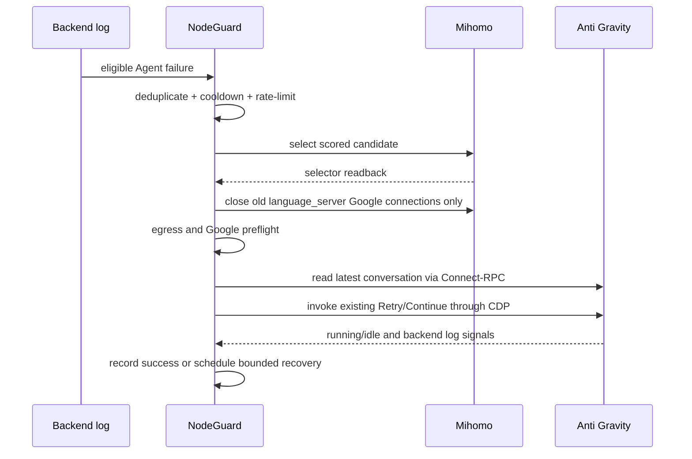

# Architecture

## Design goals

NodeGuard keeps Anti Gravity network recovery independent from the user's foreground and from every other application's proxy selection. The core invariants are:

1. Only the Anti Gravity `language_server` process is routed through the managed selector.
2. Clash Verge's active profile and existing selector choices are preserved.
3. A health endpoint or generic HTTP probe alone never proves Agent availability.
4. Private or version-sensitive interfaces fail closed; there is no screen-automation fallback.
5. Subscription URLs, proxy credentials, CSRF values, and conversation content never cross the public CLI boundary.

## Components

| Component | Responsibility |
| --- | --- |
| Go CLI/daemon | Lifecycle, monitoring, recovery orchestration, JSON interface |
| Subscription catalog | Safe profile index parsing, direct-node extraction, namespacing, fingerprints |
| Installer/reconciler | Managed runtime synthesis, Mihomo validation, enhancement backups and rollback |
| Mihomo adapter | Unix Socket discovery, version/proxy/delay/connection APIs, safe loopback fallback |
| Anti Gravity adapter | `/healthz`, Connect-RPC conversation state, CDP Retry action |
| Log watcher | Rotation-safe event tracking and strict Agent failure/success classification |
| State store | Latency history, success/failure stats, cooldowns, switch window, Retry deduplication |
| SwiftUI app | Fixed-argument CLI client, NDJSON status stream, menu bar and dashboard |

## Subscription model

NodeGuard reads Clash Verge's `profiles.yaml` and follows only `remote` items whose profile and enhancement files are regular YAML files inside the Clash `profiles` directory. Unsafe UIDs, path traversal, unexpected extensions, and symlinks are rejected.

Each direct proxy is assigned an internal runtime name derived from:

```text
subscription UID + original node name
```

The dashboard and public JSON keep the original display name and expose only the non-secret subscription UID/name metadata. The namespace prevents two subscriptions with an identically named node from sharing latency, cooldown, success, or exit-IP history.

All supported direct proxies are cloned into the managed local configuration. The `AntiGravity-Agent` selector itself contains only eligible leaf nodes from allowed regions. Provider-only profiles remain visible for diagnostics but do not contribute nodes in v0.5.0.

## Managed routing

For each valid remote profile, NodeGuard manages three Clash Verge enhancement files:

- Proxies: namespaced direct proxy definitions.
- Groups: one hidden `AntiGravity-Agent` selector.
- Rules: two leading `PROCESS-PATH` rules for the Anti Gravity language server.

It never writes a subscription URL and never changes `profiles.current`. The running configuration is synthesized as `ag-nodeguard-runtime.yaml`, validated by Mihomo, written atomically with mode `0600`, and loaded through the controller API. Existing selectors are read before reload and restored afterwards.

Enhancement files are backed up once and tracked in a local manifest. Reconciliation is idempotent: managed entries are replaced, not appended. A validation, reload, selection, or inventory failure restores the previous runtime, enhancement files, and preferred-subscription setting.

## Health and failure classification

NodeGuard combines three local signals:

- `/healthz` confirms the local language server is reachable.
- Connect-RPC supplies the latest conversation identity and running/idle transition.
- `language_server.log` supplies Agent executor failures and successful streaming responses.

Only geographic rejection, DNS failure, connection reset, timeout, and `UNAVAILABLE` from an Agent executor path cause proxy recovery. Updater, quota, authentication, model, media, MCP, and workspace-file failures are ignored as node-selection signals.

## Candidate policy

Successful delay probes below `green_threshold_ms` become candidates. Informational entries, groups, `DIRECT`, and `REJECT` are excluded. Sorting considers:

1. Preferred subscription membership.
2. Prior real Agent success.
3. Success/failure ratio.
4. Active cooldown and recent failure.
5. Region preference, latency, and jitter.

Fallback nodes are considered only if the preferred subscription has no green node outside cooldown. When a preferred node becomes usable again, NodeGuard switches back only if the latest Agent conversation is idle or on the next failure.

## Recovery transaction



Manual subscription selection changes only future routing. It does not close the current Agent stream and does not invoke Retry.

## Concurrency and persistence

A filesystem operation lock serializes recovery, subscription rebuild, and manual subscription selection across the daemon and desktop CLI. State and configuration files are replaced atomically. The daemon separately holds a non-blocking singleton lock.

Default local paths:

| Data | Path |
| --- | --- |
| Config/state/binary | `~/Library/Application Support/AntiGravityNodeGuard/` |
| Daemon log | `~/Library/Logs/AntiGravityNodeGuard/nodeguard.log` |
| LaunchAgent | `~/Library/LaunchAgents/com.local.ag-nodeguard.plist` |
| UI LaunchAgent | `~/Library/LaunchAgents/com.local.ag-nodeguard-ui.plist` |
| Managed runtime | Clash Verge application support directory |

Config, runtime, state, log, manifests, and LaunchAgent files are created with private permissions (`0600` or `0700` directories; LaunchAgents enforce umask `077`).

## Public interfaces

The stable integration boundary is the CLI documented in the README. SwiftUI launches it through `Foundation.Process` with a fixed argument enum; no command is passed through a shell. `status --watch --json` is newline-delimited JSON and reconnects with bounded exponential backoff.

Mihomo, Connect-RPC, and CDP adapters are internal compatibility layers. They must version-check or stop on ambiguous responses rather than guessing.
