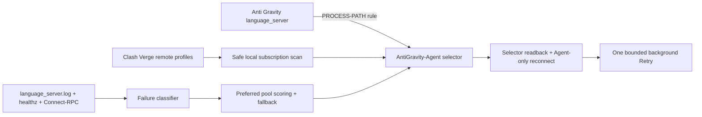

# Anti Gravity NodeGuard

[简体中文](README.zh-CN.md) · [Architecture](ARCHITECTURE.md) · [Troubleshooting](TROUBLESHOOTING.md) · [Security](SECURITY.md)

Anti Gravity NodeGuard is an unofficial macOS menu-bar app and background daemon that keeps Anti Gravity agent traffic on a healthy Mihomo/Clash Verge proxy node. It watches backend health signals, rotates only the dedicated Anti Gravity route, and can invoke the app's own Retry action through a background CDP target without mouse automation or bringing Anti Gravity to the foreground.

> [!IMPORTANT]
> This project is not affiliated with, endorsed by, or supported by Google, Anti Gravity, Clash Verge Rev, or Mihomo. It integrates with local and partly internal interfaces that may change without notice. When compatibility is uncertain, NodeGuard stops rather than falling back to screen automation.

## Highlights

- Native SwiftUI menu-bar app with a full live dashboard.
- Go `launchd` daemon with no Dock icon, window, mouse automation, or AppleScript.
- Reads all direct-node remote subscriptions from Clash Verge without changing its active profile.
- Isolates duplicate node names by subscription UID and routes only the Anti Gravity `language_server` process through `AntiGravity-Agent`.
- Prefers green nodes (`<250 ms`) from the selected subscription and uses other supported subscriptions only when the preferred pool is exhausted.
- Classifies backend Agent errors from `language_server.log`; updater, quota, authentication, model, media, and project-file errors do not trigger failover.
- On an eligible network failure: select node → confirm selector → close only old Agent Google connections → verify egress → background Retry.
- Protects against loops with cooldowns, switch-rate limits, failure deduplication, and one Retry per task/node window.
- Redacts subscription URLs, credentials, CSRF values, and conversation content from CLI output and logs.

## Compatibility

| Component | Tested version |
| --- | --- |
| macOS | 14+; Apple Silicon release build |
| Clash Verge Rev | 2.5.x |
| Mihomo | 1.19+ (1.x) |
| Anti Gravity | 2.8.x |

Remote profiles with concrete `proxies` lists are supported. Provider-only subscriptions are detected and shown as unsupported in v0.5.0; their URLs are never copied.

## Installation

### Download the app

Download `Anti-Gravity-NodeGuard-0.5.0-arm64.zip` from the [v0.5.0 release](https://github.com/TTXXCC789/ag-nodeguard/releases/tag/v0.5.0), verify it against `SHA256SUMS.txt`, and move the app to `/Applications`.

The downloadable app is ad-hoc signed and **not notarized with an Apple Developer ID**. macOS may require an explicit approval in Privacy & Security. Do not run the binary if you do not trust it; build from source instead.

On first launch, choose **Install background service**. Installation changes local Clash enhancement files only after validation and keeps recoverable backups.

### Build from source

Requirements: macOS 14+, Apple Command Line Tools/Xcode, Go 1.26+, and Clash Verge Rev running with Mihomo.

```sh
git clone https://github.com/TTXXCC789/ag-nodeguard.git
cd ag-nodeguard
go test ./...
GO_BIN="$(command -v go)" ./macos-app/scripts/build-app.sh
./macos-app/scripts/install-app.sh
"/Applications/Anti Gravity NodeGuard.app/Contents/Resources/ag-nodeguard" install
```

## Using the dashboard

1. Keep **Automatic switching** enabled.
2. Select a **Preferred subscription**. This changes only the dedicated Anti Gravity pool.
3. Use **Refresh subscriptions** after adding or refreshing a Clash Verge profile; the daemon also scans every 10 seconds.
4. The candidate table shows latency, subscription source, validation history, and cooldown status.
5. A yellow **Fallback** state means the preferred pool has no usable green nodes. NodeGuard returns when the preferred pool is green and the Agent is idle.

Turning automatic switching off pauses node changes and Retry while health and subscription monitoring continue. Quitting the UI does not stop the daemon.

## CLI

The app embeds the same `ag-nodeguard` binary used by the background service.

```text
ag-nodeguard install|uninstall
ag-nodeguard start|stop|pause|resume
ag-nodeguard status [--json] [--watch --interval 2s]
ag-nodeguard once [--dry-run]
ag-nodeguard recover
ag-nodeguard doctor
ag-nodeguard candidates [--json]
ag-nodeguard subscriptions [--refresh] [--json]
ag-nodeguard subscription select --uid <uid> [--json]
ag-nodeguard tail
```

`once --dry-run` measures and scores candidates without switching. `once` performs a controlled switch without Retry. `recover` performs a bounded failover and asks Anti Gravity to Retry the latest eligible failed task in the background.

## How it works



See [ARCHITECTURE.md](ARCHITECTURE.md) for the data flow, managed files, recovery transaction, and rollback model.

## Privacy and safety

NodeGuard necessarily reads local Clash profile proxy definitions to construct the dedicated runtime configuration. Those definitions stay on the Mac, are written with mode `0600`, and are never returned by the public JSON interfaces. The project has no analytics or telemetry endpoint.

Automatic Retry may re-submit an Agent operation and may consume model quota. NodeGuard deduplicates failures, limits switching, and fails closed when the task state or CDP action is ambiguous. Review [SECURITY.md](SECURITY.md) before reporting a problem and redact all local subscription and conversation data.

## Development

```sh
go test ./...
go test -race ./...
go vet ./...
./macos-app/scripts/test-swift.sh
GO_BIN="$(command -v go)" ./macos-app/scripts/build-app.sh
```

See [CONTRIBUTING.md](CONTRIBUTING.md) for contribution rules and [CHANGELOG.md](CHANGELOG.md) for release history.

## License and acknowledgements

NodeGuard is released under the [MIT License](LICENSE). It does not copy Clash Verge Rev GPL source. Public behavior and transaction boundaries were studied independently; MetaCubeXD informed the selector/delay workflow. See [THIRD_PARTY_NOTICES.md](THIRD_PARTY_NOTICES.md) for licenses and links.
