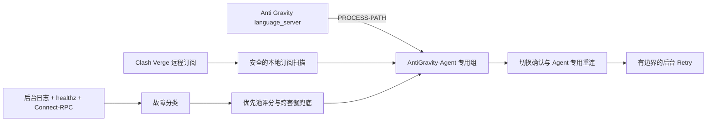

# Anti Gravity NodeGuard

[English](README.md) · [架构](ARCHITECTURE.md) · [故障排查](TROUBLESHOOTING.md) · [安全说明](SECURITY.md)

Anti Gravity NodeGuard 是一个非官方 macOS 菜单栏应用和后台守护程序。它通过 Clash Verge 内嵌 Mihomo 的本地 API 为 Anti Gravity 维护独立代理节点池，读取后台日志判断 Agent 网络故障，并可通过应用自身的 CDP 页面在后台执行 Retry；不使用鼠标、AppleScript、截图识别，也不强制激活 Anti Gravity 窗口。

> [!IMPORTANT]
> 本项目与 Google、Anti Gravity、Clash Verge Rev、Mihomo 没有隶属、授权或官方支持关系。所依赖的内部接口可能随版本变化；兼容性不明确时程序会停止，不会退化成前台屏幕自动化。

## 核心能力

- SwiftUI 菜单栏常驻与完整实时仪表盘。
- Go `launchd` 守护程序，不占用 Dock，不操作前台窗口。
- 自动读取 Clash Verge 所有包含具体 `proxies` 的远程订阅，不改变 Clash 当前 profile。
- 用“订阅 UID + 节点名”隔离跨订阅重名节点，只路由 Anti Gravity `language_server`。
- 优先选择用户指定套餐内 `<250 ms` 的绿色节点；优先池耗尽时才跨套餐兜底。
- 只把 Agent executor 的地域拒绝、DNS、连接重置、超时和 `UNAVAILABLE` 视为节点故障。
- 故障恢复顺序固定：选节点、API 切换、回读确认、只关闭旧 Agent Google 连接、检查出口、后台 Retry。
- 冷却、失败去重、窗口限速及每任务/节点一次 Retry，避免循环与重复额度消耗。
- CLI、状态 JSON 和日志不输出订阅 URL、代理凭据、CSRF 或对话内容。

## 兼容范围

| 组件 | 已测试版本 |
| --- | --- |
| macOS | 14+；Release 为 Apple Silicon |
| Clash Verge Rev | 2.5.x |
| Mihomo | 1.19+（1.x） |
| Anti Gravity | 2.8.x |

v0.5.0 支持带具体 `proxies` 列表的远程订阅。仅包含 `proxy-providers` 的订阅会显示“暂不支持”，程序不会复制其订阅地址。

## 安装

### 下载应用

从 [v0.5.0 Release](https://github.com/TTXXCC789/ag-nodeguard/releases/tag/v0.5.0) 下载 `Anti-Gravity-NodeGuard-0.5.0-arm64.zip`，并用 `SHA256SUMS.txt` 校验后放入 `/Applications`。

应用采用 ad-hoc 签名，**没有 Apple Developer ID 公证**，macOS 可能要求在“隐私与安全性”中明确批准。若不信任预编译文件，请自行从源码构建。

第一次启动后点击“安装后台服务”。安装程序会先验证 Clash 托管配置，失败时恢复运行配置和增强文件。

### 从源码构建

```sh
git clone https://github.com/TTXXCC789/ag-nodeguard.git
cd ag-nodeguard
go test ./...
GO_BIN="$(command -v go)" ./macos-app/scripts/build-app.sh
./macos-app/scripts/install-app.sh
"/Applications/Anti Gravity NodeGuard.app/Contents/Resources/ag-nodeguard" install
```

## 使用仪表盘

1. 保持“自动切换”开启。
2. 在“订阅套餐”中选择优先套餐；该选择只影响 Anti Gravity。
3. 新增或更新 Clash 订阅后点击“刷新订阅”，守护程序也会每 10 秒自动扫描。
4. 候选表展示节点来源、延迟、真实 Agent 验证记录和冷却状态。
5. 黄色“兜底中”表示优先套餐暂时没有绿色节点；Agent 空闲且优先套餐恢复后会安全回切。

关闭自动切换只暂停节点变化和 Retry，健康检查与订阅扫描仍继续。退出桌面界面不会停止后台守护程序。

## CLI 命令

```text
ag-nodeguard install|uninstall
ag-nodeguard start|stop|pause|resume
ag-nodeguard status [--json] [--watch --interval 2s]
ag-nodeguard once [--dry-run]
ag-nodeguard recover
ag-nodeguard doctor
ag-nodeguard candidates [--json]
ag-nodeguard subscriptions [--refresh] [--json]
ag-nodeguard subscription select --uid <uid> [--json]
ag-nodeguard tail
```

`once --dry-run` 只测速评分；`once` 做一次受控切换但不 Retry；`recover` 执行有边界的故障恢复并请求 Anti Gravity 在后台 Retry 最近的合格失败任务。

## 架构



详细的数据流、托管文件、回滚方式和并发控制见 [ARCHITECTURE.md](ARCHITECTURE.md)。

## 隐私与风险

为了生成 Anti Gravity 专用运行配置，NodeGuard 必须读取本地 Clash profile 中的代理定义。这些数据只保留在本机，托管文件权限为 `0600`，公共 JSON 不会返回代理定义，项目没有统计或遥测服务。

自动 Retry 可能重新提交 Agent 操作并消耗模型额度。程序会去重失败、限制切换次数，并在任务状态或 CDP 动作不明确时停止。报告问题前请阅读 [SECURITY.md](SECURITY.md)，不要提交订阅地址、凭据、完整日志或对话内容。

## 开发与测试

```sh
go test ./...
go test -race ./...
go vet ./...
./macos-app/scripts/test-swift.sh
GO_BIN="$(command -v go)" ./macos-app/scripts/build-app.sh
```

贡献说明见 [CONTRIBUTING.md](CONTRIBUTING.md)，版本记录见 [CHANGELOG.md](CHANGELOG.md)。

## 许可证与致谢

项目采用 [MIT License](LICENSE)。项目没有复制 Clash Verge Rev 的 GPL 源码，只独立复现公开 API 行为和配置事务边界；节点测速与 selector 工作流参考 MetaCubeXD 的公开设计。完整依赖和许可证见 [THIRD_PARTY_NOTICES.md](THIRD_PARTY_NOTICES.md)。
